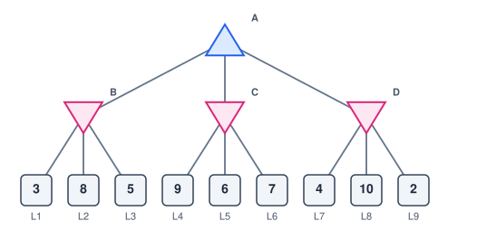
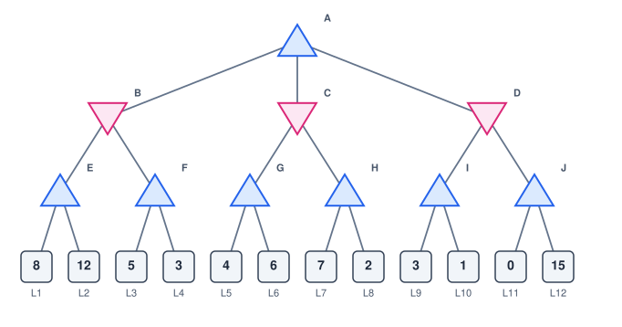
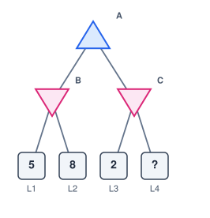
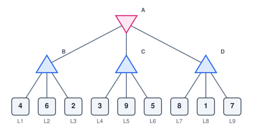
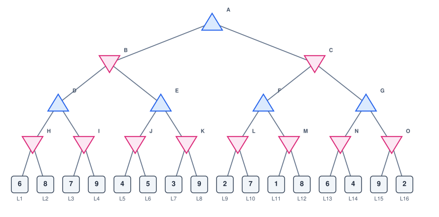

# Alpha-Beta Pruning: In-Class Practice

**Name(s):** ______________________________  **Date:** ____________

Work with a partner, using pencil and paper. Plan on about 60–75 minutes. Go through the alpha-beta slides first: **alphabeta.pptx**, posted with the course slides. You should already be comfortable with minimax. Problems 1–5 cover the algorithm, 6–7 apply it to tic-tac-toe and to move order, and 8–10 go further. **Show your work:** write each node's value next to it as you go, and cross out everything alpha-beta skips.

---

## Conventions (read these first)

- **MAX** nodes are drawn as ▲ triangles pointing up, **MIN** nodes as ▼ triangles pointing down, and leaves as squares.
- Every score is from **MAX's point of view**: MAX wants it high, MIN wants it low.
- Children are searched **left to right**. Nodes are named A, B, C, ... level by level; leaves are numbered L1, L2, ... from left to right.
- **Skipped work:** cross out every leaf alpha-beta never examines. If a whole node is never called, cross out that node and everything below it.
- **Values after a cutoff:** a node that stops early only knows a **bound** on its value. Write **≥** in front of a MAX node's value ("at least") and **≤** in front of a MIN node's value ("at most").
- **Tic-tac-toe:** X is MAX and O is MIN. A finished game scores **+1** if X wins, **0** for a draw and **−1** if O wins. Squares are numbered 0–8, left to right and top to bottom.

## Reference: alpha and beta

- **alpha (α)** is the best value MAX is already guaranteed somewhere on the path from the root. It starts at −∞ and only goes **up**, when a MAX node finds something better.
- **beta (β)** is the best (lowest) value MIN is already guaranteed somewhere on the path from the root. It starts at +∞ and only goes **down**, when a MIN node finds something better.
- Each call receives its parent's α and β. As soon as **α ≥ β** at a node, the rest of that node's children can be skipped: a player higher up already has a choice **at least as good**, so nothing below this node can change the result.

## Reference: alpha-beta pruning

```
alphabeta(node, isMax, alpha, beta):      start with alpha = −∞, beta = +∞
  if node is a leaf: return score(node)
  if isMax:
    best = −∞
    for each child c (left to right):
      best = max(best, alphabeta(c, false, alpha, beta))
      alpha = max(alpha, best)
      if alpha >= beta: stop (skip the remaining children)
  else:
    best = +∞
    for each child c (left to right):
      best = min(best, alphabeta(c, true, alpha, beta))
      beta = min(beta, best)
      if alpha >= beta: stop (skip the remaining children)
  return best
```

<!-- pagebreak -->

## Problem 1: True or false?

Mark each statement true or false, and give a one-line reason.

| Statement | True / false | Why |
|---|---|---|
| Alpha-beta can return a different root value than minimax. | | |
| Alpha-beta always examines fewer leaves than minimax. | | |
| Along one path from the root, α can only go up and β can only go down. | | |
| A cutoff at a MIN node means MAX already has a choice at least as good somewhere higher up. | | |
| When a node stops early, the value it returns is its true minimax value. | | |

## Problem 2: A two-level tree



a. Run alpha-beta (children left to right). Cross out every leaf that is never examined.
b. For each MIN node, write the values of α and β at the moment it returns, and the value it returns.
c. What is the root's value, and which move should MAX make?
d. For each leaf you crossed out, explain in one sentence why it can't change the answer.

> **Hint:** nothing under B can be skipped. MAX doesn't have a guaranteed value until B returns.

<!-- workspace:fill:Work space -->

<!-- pagebreak -->

## Problem 3: A three-level tree



a. Run alpha-beta. Cross out every leaf that is never examined, and every node that is never called.
b. Write each node's value, using ≥ or ≤ for any node that stopped early. What is the root's value, and which move should MAX make?
c. How many of the 12 leaves does alpha-beta examine?
d. One cutoff happens at a MAX node and one at a MIN node. Name each node, give α and β at the moment of the cutoff, and say which player already has a choice at least as good.

> **Hint:** inside a MAX node, α can rise above the β it was handed. That is a cutoff too.

<!-- workspace:fill:Work space -->

<!-- pagebreak -->

## Problem 4: Tracing alpha and beta

Use the Problem 3 tree.

a. List every internal node that alpha-beta calls, in the order it calls them. For each one, write the α and β it **receives** from its parent.
b. Write the call stack at the moment of the cutoff at the MAX node, from the first call (the root) to the current call. Include each call's current α and β.
c. Which internal nodes are never called? Why does that save more work than skipping a single leaf?

> **Hint:** a child receives its parent's **current** α and β, which may have changed since the parent was called.

<!-- workspace:fill:Work space -->

<!-- pagebreak -->

## Problem 5: Why is skipping safe?



The value of leaf L4 is hidden.

a. Run alpha-beta. Which leaf is skipped? What is the root's value?
b. For which values of L4, if any, would the root's value be different? Explain.
c. Alpha-beta returns 2 for node C. Is that C's true minimax value? What does the 2 tell you about C?

<!-- workspace:fill:Work space -->

<!-- pagebreak -->

## Problem 6: Tic-tac-toe with alpha-beta

X to move. The small numbers mark the empty squares.


a. Draw the game tree. Search X's moves in square order (1, then 2, then 4), and each reply in square order too.
b. Run alpha-beta on your tree. Score each finished game (+1, 0 or −1), pass the values up, and cross out every position that is never examined.
c. Which move should X play, and what is the result with best play?
d. The cutoff happens with α = β. Why is it right to stop when they are equal, not only when α > β?
e. If X tried square 2 first, how many finished games would alpha-beta examine? (In square order, how many does it examine?)

> **Hint:** once X has found a win (+1), nothing can beat it. Any O reply that holds X to +1 or less rules that move out.

<!-- workspace:fill:Work space -->

<!-- pagebreak -->

## Problem 7: Move order

Use the Problem 3 tree. You may reorder the children of any node; the tree's shape and leaf values stay the same.

a. Find an order that lets alpha-beta examine as **few** leaves as possible. How many does it examine? Draw the reordered tree and cross out the skipped leaves.
b. Find an order that makes alpha-beta skip **nothing**. How many leaves does it examine then?
c. In one or two sentences, state the rule for a good order: which child should be searched first at a MAX node, and at a MIN node?

<!-- workspace:fill:Work space -->

<!-- pagebreak -->

## Problem 8: When MIN moves first



a. Run alpha-beta (the root is a MIN node). Cross out every leaf that is never examined.
b. What is the root's value, and which move should MIN make?
c. Where do the cutoffs happen this time: at MAX nodes or at MIN nodes? Which of α or β causes them?

<!-- workspace:fill:Work space -->

<!-- pagebreak -->

## Problem 9: A deeper tree



a. Run alpha-beta. Cross out every leaf that is never examined and every node that is never called. What is the root's value?
b. One cutoff happens at a MIN node whose **parent has not found any value yet**. Find it. Where did the α that caused it come from?
c. Why does alpha-beta pass α and β down the whole tree, instead of each node only comparing itself with its parent?

> **Hint:** a node's α and β can come from any ancestor, not just its parent.

<!-- workspace:fill:Work space -->

<!-- pagebreak -->

## Problem 10: Alpha-beta in practice

Real programs combine alpha-beta with a **depth limit** (from the minimax practice): when the count of moves left reaches 0, they **estimate** the score.

```
alphabeta(node, depth, isMax, alpha, beta):
  if the game is over at node: return score(node)
  if depth == 0: return estimate(node)
  if isMax:
    best = −∞
    for each child c (best-looking first):
      best = max(best, alphabeta(c, depth − 1, false, alpha, beta))
      alpha = max(alpha, best)
      if alpha >= beta: stop (skip the remaining children)
  else:
    best = +∞
    for each child c (best-looking first):
      best = min(best, alphabeta(c, depth − 1, true, alpha, beta))
      beta = min(beta, best)
      if alpha >= beta: stop (skip the remaining children)
  return best
```

a. Chess has about b = 35 moves in each position. A program can afford to score about 1,000,000 leaf positions per move. How deep can plain minimax search (b^d leaves)? How deep can alpha-beta search with perfect move order (b^(d/2 rounded up) + b^(d/2 rounded down) − 1 leaves)?
b. Why can't a real program get the perfect move order? Propose a quick rule for ordering moves in Connect 4.
c. Two programs use the same estimate and search to depth 6, trying moves in the same order and switching to a new move only when it is strictly better. One runs depth-limited minimax, the other depth-limited alpha-beta. Do they return the same value? Do they choose the same move? Then why does alpha-beta play better in practice?
d. Many programs search to depth 1, then depth 2, then 3, and so on, each time trying the previous search's best move first. That repeats work. Why can it still finish a deep search faster than going straight to that depth?

<!-- workspace:fill:Work space -->
