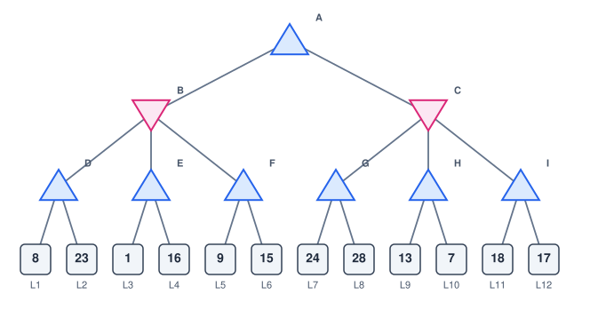
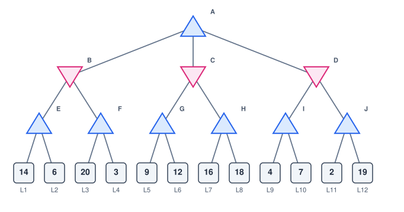
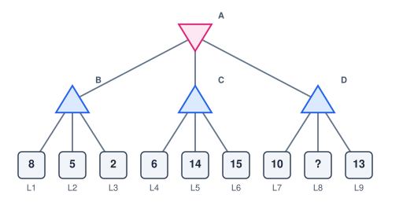
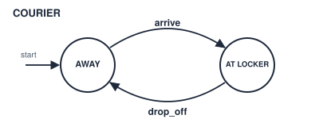
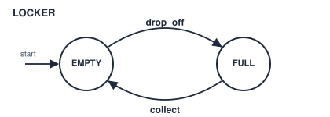
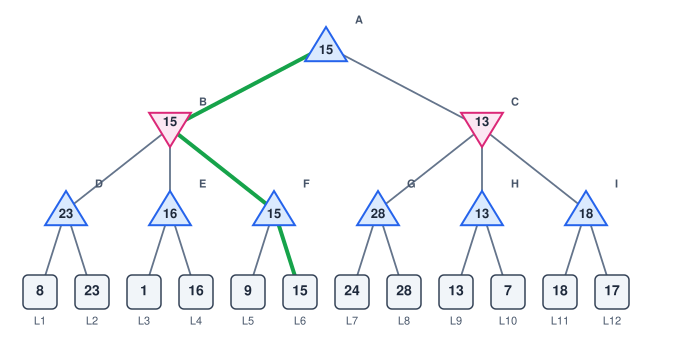
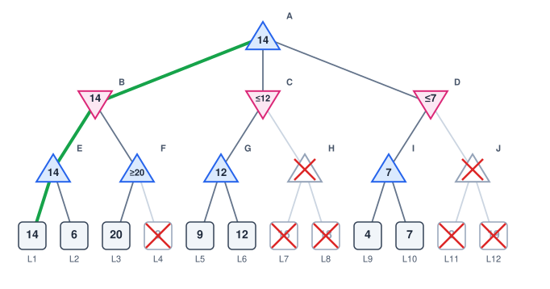
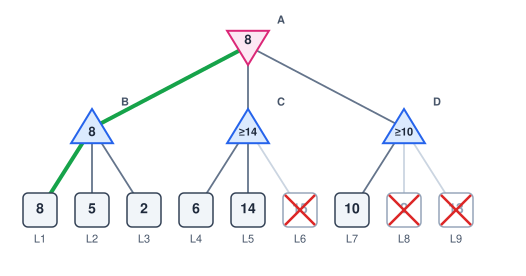
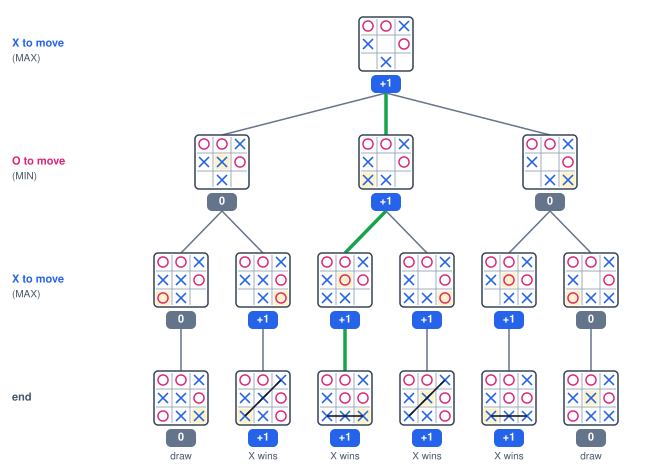

# CIS 3723 - Computer Science II: Final Exam Practice

**Name:** ______________________________

This practice exam has the same kinds of questions as the final, with different trees, positions and programs. Plan on about **60 minutes**. Work the way you will on the final: pencil and paper, one page of notes, no devices. **Explain your work:** show each step, not just the final answer.

---

## Conventions

These are the same conventions the final exam uses.

- **Game trees:** MAX nodes are triangles pointing up, MIN nodes are triangles pointing down, and leaves are squares. Every score is from **MAX's point of view**. Children are searched **left to right**. Nodes are named A, B, C, ... level by level; leaves are numbered L1, L2, ... from left to right.
- **Alpha-beta:** cross out every leaf that is never examined. If a whole node is never called, cross out that node and everything below it. A node that stops early only knows a bound on its value: write **≥** in front of a MAX node's value and **≤** in front of a MIN node's value.
- **Tic-tac-toe:** X is MAX and O is MIN. A finished game scores **+1** if X wins, **0** for a draw and **−1** if O wins. Squares are numbered 0–8, left to right and top to bottom.
- **Shared variables:** an assignment such as `x := x + 1` is two atomic steps: **R** (read `x` into a private register), then **W** (write the new value back to `x`).
- **State diagrams:** circles are states, arrows are labelled with actions, and an arrow from nowhere marks the start state. An action that appears in two processes' diagrams is **shared**: both must do it at the same moment.
- **Java:** the code is Java 21. Make no assumptions about how fast any thread runs.

| Question | Topic | Points |
|---|---|---|
| 1 | Minimax | 10 |
| 2 | Alpha-beta pruning | 14 |
| 3 | Alpha-beta: MIN moves first | 8 |
| 4 | Tic-tac-toe | 8 |
| 5 | A race condition | 10 |
| 6 | Drawing a state diagram | 8 |
| 7 | Interleaving and shared actions | 10 |
| | **Total** | **68** |

<!-- pagebreak -->

## Question 1: Minimax (10 points)



a. Write the minimax value of every internal node (A to I).
b. Which move should MAX make at the root, and what is the root's value? Mark the **principal variation**: the path both players follow if both play perfectly.
c. Minimax searches depth-first. In what order do the internal nodes **return** their values?
d. The largest leaf is 28. Why can't MAX get it?

<!-- workspace:fill:Work space -->

<!-- pagebreak -->

## Question 2: Alpha-beta pruning (14 points)



a. Run alpha-beta (children left to right). On the tree, cross out every leaf that is never examined and every node that is never called, and write each node's value (with ≥ or ≤ for any node that stopped early).
b. What is the root's value, and which move should MAX make?
c. Fill in the table: list every internal node alpha-beta **calls**, in the order it calls them, with the α and β it **receives** from its parent and the value it returns. You may not need every row.

| Order | Node | α received | β received | Returns |
|---|---|---|---|---|
| 1 | | | | |
| 2 | | | | |
| 3 | | | | |
| 4 | | | | |
| 5 | | | | |
| 6 | | | | |
| 7 | | | | |
| 8 | | | | |
| 9 | | | | |
| 10 | | | | |

d. Choose **one** cutoff. Name the node, give α and β at the moment of the cutoff, and explain which player already has a choice at least as good, and where.

<!-- pagebreak -->

## Question 2 (continued)

<!-- workspace:fill:Work space for Question 2 -->

<!-- pagebreak -->

## Question 3: Alpha-beta: MIN moves first (8 points)

The root is a **MIN** node this time. The value of leaf L8 is hidden.



a. Run alpha-beta (children left to right). Cross out every leaf that is never examined, and write each node's value (with ≥ or ≤ for any node that stopped early).
b. What is the root's value, and which move should MIN make?
c. For which values of L8, if any, would the root's value be different? Explain.
d. Do the cutoffs in this tree happen at MAX nodes or at MIN nodes? Which of α or β causes them?

<!-- workspace:fill:Work space -->

<!-- pagebreak -->

## Question 4: Tic-tac-toe (8 points)

X to move. The small numbers mark the empty squares.


a. Draw the game tree: X's three possible moves, O's replies, and X's last move, until each game ends.
b. Score every finished game (+1, 0 or −1) and pass the values up the tree using minimax.
c. Which move should X play, and what is the result with best play? Explain in one or two sentences why that move works.

<!-- workspace:fill:Work space -->

<!-- pagebreak -->

## Question 5: A race condition (10 points)

A shared variable `x` starts at **3**. Two processes run at the same time:

```
process 1:   x := x - 1        R1 then W1
process 2:   x := x * 3        R2 then W2
```

a. List all six possible orders of R1, W1, R2, W2 (each process keeps its own R before its W), and the final value of `x` for each.

| | Order of the four steps | Final x |
|---|---|---|
| 1 | | |
| 2 | | |
| 3 | | |
| 4 | | |
| 5 | | |
| 6 | | |

b. Which final values are possible? Which of them could also happen if the two processes ran one after the other, with no overlap?
c. Pick one order that gives a final value that could **not** happen one after the other. Explain, step by step, what went wrong.
d. A teammate runs this program 1,000 times and always gets 6. They conclude it has no race condition. What is wrong with that reasoning?

<!-- workspace:fill:Work space -->

<!-- pagebreak -->

## Question 6: Drawing a state diagram (8 points)

A scooter-sharing app tracks one scooter. The scooter starts **AVAILABLE**. A rider can `reserve` an available scooter, which makes it **RESERVED**, or `unlock` it straight away, which makes it **RIDING**. A reserved scooter can be unlocked by the rider (it becomes RIDING), or the reservation can `expire`, which makes it AVAILABLE again. While riding, the rider can `lock` the scooter for a short stop, which makes it **PARKED**; unlocking a parked scooter makes it RIDING again. While riding or parked, the rider can `end_ride`, which makes the scooter AVAILABLE.

a. Draw the state diagram: circles for the four states, arrows labelled with actions. Mark the start state.

<!-- workspace:3.6:State diagram -->

b. Which of these are traces of your diagram? For each one that is not, say where it gets stuck.
(i) `reserve unlock lock unlock end_ride`  (ii) `unlock reserve`  (iii) `reserve expire unlock end_ride`  (iv) `reserve lock end_ride`

| Sequence | Trace? | Why |
|---|---|---|
| (i) | | |
| (ii) | | |
| (iii) | | |
| (iv) | | |

<!-- pagebreak -->

## Question 7: Interleaving and shared actions (10 points)

```java
System.out.println("start");
Thread loader = new Thread(() -> {
    System.out.println("fetch");
    System.out.println("show");
});
Thread logger = new Thread(() -> {
    System.out.println("log");
});
loader.start();
logger.start();
loader.join();
System.out.println("done");
logger.join();
```

a. List every output this program can produce (one line per output, words in order).
b. Can it print `start fetch show done log`? `start show fetch log done`? `log start fetch show done`? Explain each.

<!-- workspace:fill:Answers to a and b -->

<!-- pagebreak -->

## Question 7 (continued)

A delivery courier and a pickup locker share the action `drop_off`, so they must do it together. They start in AWAY and EMPTY.





c. Which of these sequences can happen? For each one that can't, say where it gets stuck.
(i) `arrive drop_off collect arrive drop_off`  (ii) `arrive drop_off arrive drop_off`  (iii) `arrive arrive`  (iv) `arrive drop_off arrive collect drop_off`

d. Suppose `arrive drop_off arrive` has happened. What is the only action that can happen next? What does that mean for the courier?

<!-- workspace:fill:Answers to c and d -->

<!-- answers -->

---

## Answers

Try every question before you open this. Figures show the principal variation in green, skipped leaves and nodes crossed out, and ≥ / ≤ for nodes that stopped early.

<details>
<summary><b>Show the answers</b></summary>

### Question 1: Minimax



**(a)** D 23, E 16, F 15, **B 15** (MIN of 23, 16, 15); G 28, H 13, I 18, **C 13** (MIN of 28, 13, 18); **A 15**.
**(b)** MAX moves to **B**; the root's value is **15**. Principal variation: A → B → F → L6 (15).
**(c)** D, E, F, B, G, H, I, C, A. A node returns only after all its children have.
**(d)** The 28 is under G, below the MIN node C. MIN at C would choose H (13) instead, so moving to C gets MAX only 13, less than the 15 from B.

### Question 2: Alpha-beta pruning



**(a)** Skipped: leaf L4 (3); node H with L7 and L8; node J with L11 and L12. Only 7 of the 12 leaves are examined. Values: E 14, F ≥ 20, B 14, G 12, C ≤ 12, I 7, D ≤ 7, A 14.
**(b)** The root's value is **14**; MAX moves to **B**.
**(c)**

| Order | Node | α received | β received | Returns |
|---|---|---|---|---|
| 1 | A (MAX) | −∞ | +∞ | 14 |
| 2 | B (MIN) | −∞ | +∞ | 14 |
| 3 | E (MAX) | −∞ | +∞ | 14 |
| 4 | F (MAX) | −∞ | 14 | ≥ 20 |
| 5 | C (MIN) | 14 | +∞ | ≤ 12 |
| 6 | G (MAX) | 14 | +∞ | 12 |
| 7 | D (MIN) | 14 | +∞ | ≤ 7 |
| 8 | I (MAX) | 14 | +∞ | 7 |

**(d)** Any one of:
- **F** (MAX), α = 20, β = 14: MIN at B already has 14 from E, and F is worth at least 20, so MIN will never choose F.
- **C** (MIN), α = 14, β = 12: MAX at the root already has 14 from B, and C is worth at most 12, so MAX will never choose C. H is never called.
- **D** (MIN), α = 14, β = 7: the same reason; D is worth at most 7. J is never called.

Because the best move (B) is searched first, α is high from the start and both later MIN nodes are cut after one child. Searching the best move first prunes the most.

### Question 3: Alpha-beta: MIN moves first



**(a)** B returns max(8, 5, 2) = 8, so β = 8 at the root. At C, 6 < 8 doesn't stop it, but 14 ≥ 8 does, skipping L6; C ≥ 14. At D, the first leaf is 10 ≥ 8, skipping L8 and L9; D ≥ 10.
**(b)** The root's value is **8**; MIN moves to **B**.
**(c)** **No value** of L8 changes the root. D is a MAX node whose first leaf is 10, so D is at least 10 whatever L8 is, and MIN already has 8 from B.
**(d)** At **MAX** nodes (C and D), caused by **β**: MIN's guarantee of 8 from B.

**Common mistake:** stopping C after the 6. Only a value ≥ β stops a MAX node.

### Question 4: Tic-tac-toe



Square 4: draw (O blocks at 6). **Square 6: X wins (+1).** Square 8: draw (O blocks at 6).
X should play **bottom-left (square 6)**. It makes two threats at once, the diagonal 2-4-6 (needs 4) and the bottom row 6-7-8 (needs 8), and O can block only one. Squares 4 and 8 each make only one threat, which O blocks by taking square 6.

### Question 5: A race condition

**(a)**

| | Order | Final x |
|---|---|---|
| 1 | R1 W1 R2 W2 | 6 |
| 2 | R1 R2 W1 W2 | 9 |
| 3 | R1 R2 W2 W1 | 2 |
| 4 | R2 R1 W1 W2 | 9 |
| 5 | R2 R1 W2 W1 | 2 |
| 6 | R2 W2 R1 W1 | 8 |

**(b)** Possible: **2, 6, 8 and 9**. One after the other gives only 6 (process 1 first: 3 − 1 = 2, then 2 × 3 = 6) or 8 (process 2 first: 3 × 3 = 9, then 9 − 1 = 8).
**(c)** Either lost update. **9:** both read 3; process 1 writes 2, then process 2 writes 3 × 3 = 9 over it, so process 1's update is lost. **2:** both read 3; process 2 writes 9, then process 1 writes 3 − 1 = 2 over it, so process 2's update is lost.
**(d)** One result, however often repeated, doesn't show that every order is safe. The bad orders may be rare on that machine and show up with more cores, a different load or different scheduling. Testing can show a bug is there, not that it isn't.

### Question 6: Drawing a state diagram

**(a)** Four states, with AVAILABLE as the start, and eight arrows:

| From | Action | To |
|---|---|---|
| AVAILABLE | `reserve` | RESERVED |
| AVAILABLE | `unlock` | RIDING |
| RESERVED | `unlock` | RIDING |
| RESERVED | `expire` | AVAILABLE |
| RIDING | `lock` | PARKED |
| PARKED | `unlock` | RIDING |
| RIDING | `end_ride` | AVAILABLE |
| PARKED | `end_ride` | AVAILABLE |

Three arrows are labelled `unlock`, but each leaves a different state, so this is not a non-deterministic choice.

**(b)**
- (i) **Yes**: AVAILABLE → RESERVED → RIDING → PARKED → RIDING → AVAILABLE.
- (ii) **No**: stuck at `reserve`. RIDING allows only `lock` or `end_ride`.
- (iii) **Yes**: AVAILABLE → RESERVED → AVAILABLE → RIDING → AVAILABLE.
- (iv) **No**: stuck at `lock`. RESERVED allows only `unlock` or `expire`.

### Question 7: Interleaving and shared actions

**(a)** Four outputs. `start` is always first, because it is printed before either thread starts. `fetch`, `show` and `done` always come in that order, because main prints `done` only after `loader.join()`. `log` can come anywhere after `start`:

```
start log fetch show done
start fetch log show done
start fetch show log done
start fetch show done log
```

**(b)** `start fetch show done log`: **yes**. Main waits only for the loader before printing `done`, so the logger may not have printed yet. `start show fetch log done`: **no**, the loader prints `show` only after `fetch`. `log start fetch show done`: **no**, `start` is printed before the logger thread is even started.

**(c)**
- (i) **Yes.**
- (ii) **No**: stuck at the second `drop_off`. The locker is FULL and can't do `drop_off` until after `collect`.
- (iii) **No**: stuck at the second `arrive`. The courier is AT LOCKER, where the only action is `drop_off`.
- (iv) **Yes**: the courier comes back while the first package is still in the locker; the second `drop_off` happens after `collect`.

**(d)** Only **`collect`**. The courier is AT LOCKER and the locker is FULL; `drop_off` needs both, and the locker isn't ready. The courier has to wait at the locker with the second package until the customer collects the first.

</details>
