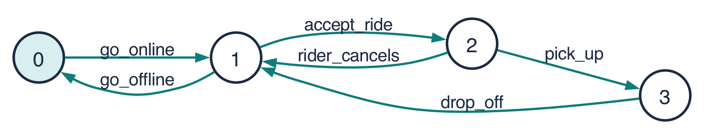

# Week 1 Tutorial: What Is Concurrency, and Why Is It Hard?

*Reading for CS II, Week 1. Based on Magee & Kramer, Concurrency: State Models & Java Programs, ch. 1 [MK06]. Keys in brackets refer to [REFERENCES.md](../REFERENCES.md).*

**After this week you should be able to:**

1. Explain the difference between a sequential and a concurrent program, and between concurrency and parallelism.
2. Give three reasons programs are written concurrently.
3. Explain what a race condition is and find every possible outcome of a small race by listing interleavings.
4. Explain why testing alone cannot show that a concurrent program is correct, and why we build models.
5. Draw a simple state machine as an abstract model of something real.

---

## 1. One thing at a time, or many?

Every program you have written so far has been **sequential**: there is a single *thread of control*. Execution starts at `main`, and at any moment you can point to exactly one line that is "running now." Run it twice with the same input and it does the same thing.

A **concurrent** program has **multiple threads of control**. Several computations are in progress at once, each with its own "current line," and they may share data.

You use concurrent programs all day:

| App | Activities happening "at the same time" |
|---|---|
| Music app | play audio, download the next song, update the lyrics display, respond to your taps |
| Web browser | each tab loads and runs separately; Chrome even runs tabs in separate operating-system *processes* so one crashed tab cannot take down the rest [Kos18] |
| Online game | draw frames, simulate physics, mix audio, exchange messages with the server |
| Web server | handle thousands of users' requests at once |
| Car | engine control, anti-lock brakes, adaptive cruise control, infotainment |

### Concurrency vs parallelism

These words are often used interchangeably, but they mean different things [Pik12]:

- **Concurrency** is about *structure*: a program is organized as several activities that are *in progress* at the same time. On a single CPU core the activities take turns, and the core switches between them so quickly that they appear simultaneous. This is called **interleaving**.
- **Parallelism** is about *execution*: actually doing several things at the same instant, on several cores.

> Rob Pike's summary: *concurrency is dealing with lots of things at once; parallelism is doing lots of things at once.* [Pik12]

A concurrent program *may* run in parallel if the hardware allows it. Its design must be correct either way.

```
One core (concurrency by interleaving):    Two cores (parallelism):
core 1: A A B B A B A A B                  core 1: A A A A A
                                           core 2: B B B B B
```

### Concurrent and distributed

When the concurrent parts run on **one machine**, they usually interact through **shared memory**: they read and write the same variables. When they run on **many machines** (your phone and a server, say), they interact by sending **messages over a network**. This module focuses on the shared-memory case, which is where most of the classic pitfalls show up first.

## 2. Why write concurrent programs?

1. **Performance on multicore hardware.** Around 2004–2005, processor clock speeds stopped rising quickly; manufacturers began adding more *cores* instead. A sequential program uses one core, so to go faster software must do work in parallel. Herb Sutter called this "the free lunch is over" [Sut05]. Your laptop probably has 8–16 cores.
2. **Throughput: don't wait idly.** Many tasks spend most of their time *waiting*, for the network, the disk or the user. While one activity waits, another can make progress. In Exercise 3, five downloads that each wait 0.3–2 seconds take 5.4 s one after another, but about 2 s concurrently.
3. **Responsiveness.** An app's user interface must keep responding while slow work happens in the background. If the code that handles your taps is stuck downloading a file, the app "freezes."
4. **Natural structure.** Some systems really are a set of independent activities: sensors, users, devices. Writing one activity per thread often gives clearer code than one giant loop that juggles everything.

## 3. Why concurrency is hard: race conditions

Here is the simplest possible concurrent program, from [MK06]. A shared variable `x` starts at 0.

```
process 1:   x := x + 1
process 2:   x := x - 1
```

What is `x` at the end? You might say 0. But `x := x + 1` is **not one step** for the computer. It is (at least) two **atomic** steps, steps that cannot be interrupted part-way:

- **R** — *read* `x` into a private register
- **W** — *write* the register's value plus one back to `x`

Call process 1's steps R1, W1 and process 2's steps R2, W2. Each process must do its own steps in order (R before W), but the two processes can be interleaved in any way. There are exactly six possible interleavings [MK06]:

| | 1 | 2 | 3 | 4 | 5 | 6 |
|---|---|---|---|---|---|---|
| step 1 | R1 | R1 | R1 | R2 | R2 | R2 |
| step 2 | W1 | R2 | R2 | R1 | R1 | W2 |
| step 3 | R2 | W1 | W2 | W1 | W2 | R1 |
| step 4 | W2 | W2 | W1 | W2 | W1 | W1 |
| **final x** | **0** | **−1** | **1** | **−1** | **1** | **0** |

Trace interleaving 2 by hand: process 1 reads 0, process 2 reads 0, process 1 writes 1, process 2 writes −1. Process 1's update has been **lost**: it was overwritten by a value computed from stale data.

This is a **race condition**: the result depends on the relative timing of the threads. The program is **non-deterministic**, meaning it can give different results on different runs with the same input.

### How bad can it get?

In Exercise 2 you will run `LikeCounter`: two threads each "like" a post 1,000,000 times using `likes = likes + 1`. The count should be 2,000,000. On a test laptop it came out around **1,020,000–1,060,000**, a different number every run. Nearly half the likes vanished. With 8 threads, about three quarters vanished.

### Why testing is not enough

Race conditions are hard to find by testing because:

- **There are a huge number of interleavings.** Two processes with *m* and *n* atomic steps have C(*m*+*n*, *n*) interleavings. Two processes of 2 steps: 6. Two processes of 4 steps: 70. Two processes of 20 steps: about 138 billion. Real programs have millions of steps.
- **The bad ones may be rare.** A test can pass 10,000 times and fail on the 10,001st run, or only on the customer's faster machine.
- **Observing changes the behaviour.** Adding print statements or a debugger changes the timing, and the bug disappears. Such bugs are nicknamed *Heisenbugs*.

> Testing can show the presence of a concurrency bug, but almost never its absence.

## 4. When concurrency goes wrong

Concurrency errors have contributed to serious real-world failures:

- **Therac-25 (1985–1987).** A computer-controlled radiation-therapy machine gave six patients massive overdoses; some died. Among the software faults was a race between the task that handled operator input and the task that set up the machine: if an experienced operator edited the treatment settings quickly, the machine could be configured inconsistently with what the screen showed [LT93].
- **Mars Pathfinder (1997).** Days after landing, the spacecraft kept resetting itself, losing data. The cause was *priority inversion*: a high-priority task waited for a lock held by a low-priority task, which was itself kept from running by medium-priority tasks. Engineers reproduced it on a ground replica and fixed it by uploading a change that turned on *priority inheritance* for that lock [Ree97].
- **Northeast blackout (2003).** About 50 million people in the U.S. and Canada lost power. A key contributing factor was a race condition in the control-room alarm software: two processes got write access to a shared data structure at the same time, the alarm process stalled, and operators did not receive alarms while the grid failed [TF04], [Reg04].

## 5. Models: thinking before building

Engineers in every discipline build **models** before they build the real thing: wind-tunnel models of aircraft, circuit simulations, structural calculations for bridges. A **model** is a simplified, *abstract* representation of a system that keeps the aspects relevant to a particular question and leaves out the rest.

### Abstraction

**Abstraction** means *removing detail to focus on what matters for your purpose*. A famous example is Harry Beck's 1933 London Underground map [Gar94]. Earlier maps drew lines geographically, with real distances and curves. Beck's diagram threw that away and kept only what a passenger needs: which stations are on which line, and where you can change. It is *wrong* about geography, yet far more useful *for its purpose*.

A good model is **fit for purpose**. Which details you keep depends on the question you want to answer.

### State machines as models

In this module our models are **state machines**, which the book calls **labelled transition systems (LTS)**. An LTS has:

- **states** (drawn as circles), one of which is the start state, and
- **transitions** between states, each labelled with an **action** (drawn as arrows).

Here is a model of a ride-share driver's status, as the dispatch system sees it:



*State 0 = OFFLINE, 1 = AVAILABLE, 2 = EN_ROUTE, 3 = ON_TRIP. Drawn by LTSA from the FSP in `models/rideshare-driver.lts`.*

Notice everything it leaves out: GPS position, fare, car model, ratings. For the question *"what can a driver do next?"* none of that matters.

Next week you will write such models in a small textual language called **FSP** (finite state processes), for example:

```
COIN = (toss -> HEADS | toss -> TAILS),
HEADS = (heads -> COIN),
TAILS = (tails -> COIN).
```

and use the **LTSA** tool to draw them, step through them, and **check them automatically**.

### Model checking

The real payoff is that a computer can **explore every reachable state and every interleaving of a model** and report problems such as deadlock or a broken safety rule, together with the exact sequence of actions that leads there. This is **model checking**. Its inventors (Clarke, Emerson and Sifakis) received the 2007 Turing Award, and the process-algebra ideas behind FSP come from Hoare's CSP and Milner's CCS, both also Turing Award work [Turing], [Hoa78], [Mil80].

Model checking is used in industry today. Engineers at Amazon Web Services, for example, have written formal models of core distributed systems and found subtle, serious bugs that testing and code review had missed [NRZ+15].

### An example to think about: cruise control

The book's running example is a car's cruise control: when the engine is on and you press *on*, it records the current speed and maintains it. Braking, accelerating or pressing *off* disables it, and *resume* re-enables it [MK06]. Modern cars add adaptive cruise control and lane-keeping on top.

- Is the system safe? Could it ever accelerate after you have braked?
- Would testing on a track be enough to find every error?

Questions like these, about all possible orderings of events, are what models answer well.

## 6. How this module works

Each week has three strands [MK06]:

| Strand | What | Tool |
|---|---|---|
| **Concepts** | the ideas: processes, interleaving, interference, synchronization, deadlock | lectures, reading |
| **Models** | finite state models of concurrent behaviour | FSP and LTSA |
| **Practice** | building real concurrent programs | Java 21+ threads |

Set up Java 21+ and LTSA now: see [SETUP.md](../SETUP.md).

---

## Key terms

| Term | Meaning |
|---|---|
| thread of control | a sequence of instructions being executed; it has a "current position" |
| sequential program | a program with one thread of control |
| concurrent program | a program with several threads of control in progress at once |
| parallelism | actually executing several things at the same instant, on several cores |
| interleaving | the order in which atomic steps of different threads happen to be executed |
| atomic action | a step that happens completely or not at all; it cannot be interrupted part-way |
| race condition | a bug where the result depends on the timing/interleaving of threads |
| non-deterministic | may produce different results from the same input |
| abstraction | removing detail to focus on what matters for a purpose |
| model | a simplified representation used to reason about a design before (or instead of) building it |
| LTS | labelled transition system: states plus action-labelled transitions |
| model checking | automatically exploring all reachable states of a model to check a property |

## Check your understanding

1. Your laptop has one core. Can a program on it be concurrent? Can it be parallel?
2. Give an example (not from this reading) of a program that benefits from concurrency even on a single core. Which reason from Section 2 applies?
3. In the `x := x + 1 || x := x - 1` example, which interleavings lose process 2's update?
4. Two processes each do `x := x + 1` once, starting from `x = 0`. What final values are possible?
5. Why might a race condition never appear while you test on your laptop but appear on a server?
6. What did Beck's map leave out, and why was that a *good* decision?

<details>
<summary>Answers</summary>

1. Yes, it can be concurrent: threads interleave on the single core. It cannot be parallel, since only one instruction stream executes at any instant.
2. Many answers. For example, a text editor that spell-checks in the background (responsiveness), or a program that downloads several files at once (throughput, since it mostly waits on the network).
3. Interleavings 3 and 5 (final x = 1): process 2 writes −1, then process 1 overwrites it with 1, a value computed from the original 0.
4. 1 or 2. It is 2 only if one process finishes both steps before the other reads.
5. The bad interleavings may need particular timing that your laptop rarely produces. A server has more cores, a different load and different scheduling, so different interleavings happen.
6. Real geography: distances, curves, the street layout. Passengers need connectivity (which line, where to change), and the simplified map shows that far more clearly. Abstraction is chosen for a purpose.

</details>
