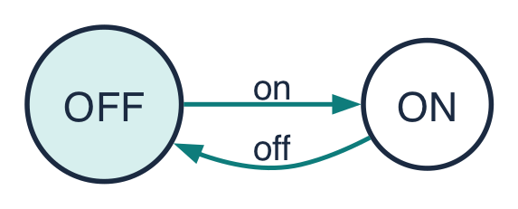
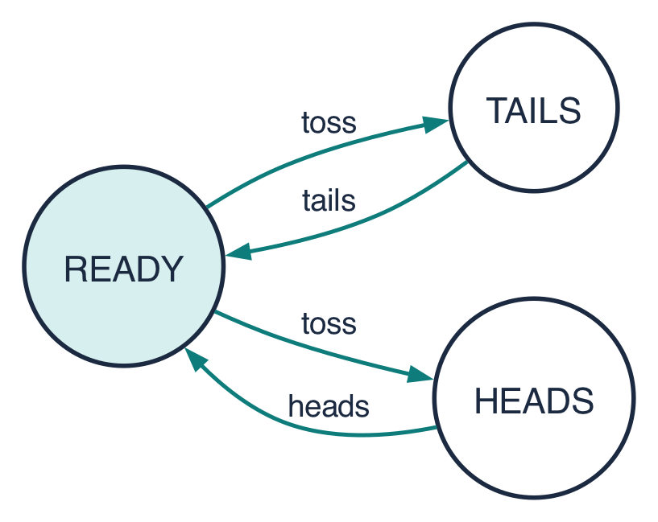

# Week 2 Tutorial: Processes and Threads

*Handout for CS II, Week 2. Follow along during the short talk, then use it as a reference for the exercises. Based on Magee & Kramer, Concurrency: State Models & Java Programs, ch. 2 [MK06]. Keys in brackets refer to [REFERENCES.md](../REFERENCES.md).*

**This week (about 100 minutes in class):** a 35-minute talk, then about 60 minutes of exercises (`exercises/README.md`).

**By the end you should be able to:**

1. Describe a process as a sequence of actions, and read its state diagram.
2. Create, start and join Java threads in four ways.
3. Describe the life of a Java thread, and stop a thread safely with `interrupt()`.
4. Turn a simple state diagram into a Java thread.

---

## Part A: Processes as state diagrams

### A.1 A process is a sequence of actions

We build a complex system out of simpler activities, each a **sequential process**: something that performs one **action** after another [MK06]. An action is an atomic step, such as `on`, `tick` or `pay`. We draw a process as a **state diagram**: circles for states, arrows labelled with actions.



A **trace** is a sequence of actions the process can perform from its start state, such as `on off on off on`. A diagram with only two states can still produce a trace that goes on forever.

> **Process vs thread.** We say *process* for the idea (and its diagram) and *thread* for the Java code that carries it out. (Operating systems also have "processes"; see B.1.)

### A.2 Processes and states

A **state** is one point (circle) in the diagram. A **process** is a *behaviour*: everything that can happen from some starting point. The two match up: **every state stands for "what can still happen from here."** Starting the light switch in OFF gives the behaviour `on off on off …`; starting it in ON gives `off on off on …`. Same diagram, different starting state, different process.

A rough analogy: a state is *where* a program is; a process is *the rest of the program from there*.

### A.3 Choice: who decides?

A state can have more than one arrow out of it. If the arrows have **different** actions, whoever performs the next action chooses (for a vending machine, the customer pressing a button).

If two arrows out of a state have the **same** action, the process itself decides which way to go, and nobody outside can control it:



After `toss`, the coin is either in TAILS or in HEADS. This is called **non-deterministic choice**, and it is a good way to describe things we cannot control, such as a network message that may or may not arrive.

### A.4 A countdown timer

Here is a timer that beeps after counting down, unless someone stops it first [MK06]:


We will turn this diagram into a Java thread in B.6. Notice DONE: it has no arrows out, so once the timer gets there, nothing more can happen. That is intended here: the timer has finished.

---

## Part B: Implementing processes as Java threads

### B.1 The operating-system view

An operating-system **process** (for example, one running program) has its own code, data (heap) and resources. To support several threads of control, it has **one stack per thread**: each thread has its own local variables and call stack, and all threads in the process **share the heap** [MK06]. That shared heap is what makes threads cheap to communicate through, and dangerous (Week 1's lost likes).

```
┌──────────── OS process ────────────┐
│  code         heap (shared data)   │
│  ┌────────┐  ┌────────┐ ┌────────┐ │
│  │stack T1│  │stack T2│ │stack T3│ │
│  └────────┘  └────────┘ └────────┘ │
└────────────────────────────────────┘
```

### B.2 Creating threads in Java

A `Thread` object manages one thread of control. The new thread runs the code in a `run()` method. There are four ways to supply it (you write all four in Exercise J1):

```java
// 1. Subclass Thread and override run()
class Greeter extends Thread {
    @Override
    public void run() { System.out.println("hello from " + getName()); }
}
Thread a = new Greeter();

// 2. Implement Runnable and give it to a Thread as its "target" (usually the better design:
//    it separates the work from the thread that runs it)
class Countdown implements Runnable {
    public void run() { /* ... */ }
}
Thread b = new Thread(new Countdown());

// 3. A lambda (Runnable has one method, so a lambda can be one)
Thread c = new Thread(() -> System.out.println("hi"));

// 4. A virtual thread (Java 21+)
Thread d = Thread.ofVirtual().unstarted(() -> System.out.println("hi"));
```

A traditional (*platform*) thread wraps an operating-system thread, which costs real resources, so programs usually limit how many they create. A **virtual thread** is managed by Java itself: when it waits (sleeping, most network and file I/O), Java frees the underlying OS thread for other work, so a program can keep many more virtual threads waiting at once [JEP444]. Virtual threads make *waiting* cheap; they do not make *computing* faster.

### B.3 `start()` vs `run()`, and `join()`

- `t.start()` **creates a new thread**, which then calls `run()`. `start()` returns immediately, so the caller and the new thread run concurrently.
- Calling `t.run()` directly is just an **ordinary method call** on the current thread. No new thread is created. This is a classic bug: the program "works" but nothing is concurrent.
- `t.join()` makes the calling thread **wait until `t` has finished**.

```java
Thread[] all = {a, b, c, d};
for (Thread t : all) t.start();   // all four run concurrently
for (Thread t : all) t.join();    // main waits for each to finish
System.out.println("all done");
```

The order in which output lines from different threads appear changes from run to run.

### B.4 The life of a thread

A thread is **created**, then **alive**, then **terminated**, and once terminated it cannot be restarted [MK06]. In between, it moves between running, ready to run, and waiting. The book draws it like this (`dispatch` and `timeslice` are the scheduler's actions, not Java methods):


Java reports a thread's state as `t.getState()` [JDK-Thread]. Here is how the Java states match the diagram:

| `Thread.State` | Meaning | In the diagram |
|---|---|---|
| `NEW` | created, not yet started | CREATED |
| `RUNNABLE` | running *or* ready to run (Java does not distinguish) | RUNNABLE or RUNNING |
| `BLOCKED` | waiting to enter a `synchronized` block (Week 4) | NON_RUNNABLE |
| `WAITING` | waiting with no time limit: `join()` | NON_RUNNABLE |
| `TIMED_WAITING` | waiting with a time limit: `sleep(ms)` | NON_RUNNABLE |
| `TERMINATED` | `run()` has returned | TERMINATED |

Exercise J2 makes a thread visit every one of these states.

### B.5 Stopping a thread: `interrupt()`

You cannot safely force another thread to stop: it might be half-way through updating shared data. (The old `Thread.stop()` now throws an exception.) Instead, Java uses **cooperative cancellation**:

- `t.interrupt()` is a *request*: it sets a flag in `t`.
- If `t` is sleeping or waiting, that request makes it throw `InterruptedException` straight away.
- The thread then cleans up and returns from `run()`.

### B.6 From diagram to code: the countdown timer

The demo program `CountdownTimer` (Maven project `demos/`) turns the countdown diagram from A.4 into a thread. Each part of the diagram maps to a part of the code:

| Diagram | Code |
|---|---|
| start (READY → 3 LEFT) | `start()`: `counter = new Thread(this); counter.start();` |
| the "i LEFT" states | a `while` loop in `run()`, with `i` as a local variable |
| tick (one second less) | `if (i > 0) { tick(i); Thread.sleep(1000); i--; }` |
| beep → DONE | `if (i == 0) { beep(); return; }`. `run()` returning means DONE: no way out. |
| stop → DONE | `stop()` calls `counter.interrupt()`; `run()` catches `InterruptedException` and returns |

```java
@Override
public void run() {
    int i = n;
    try {
        while (true) {
            if (i > 0) {                 // tick: one second less
                tick(i);
                Thread.sleep(1000);
                i--;
            }
            if (i == 0) {                // beep -> DONE
                beep();
                return;
            }
        }
    } catch (InterruptedException e) {   // stop -> DONE
        System.out.println("stopped at " + i);
    }
}
```

Meanwhile the **main thread** stays responsive: it watches for the Enter key and calls `stop()`. That is the *responsiveness* reason for concurrency from Week 1. Exercise J3 asks you to do the same for a different diagram, a phone's auto-lock.

---

## Key terms

| Term | Meaning |
|---|---|
| process | a behaviour: a sequence of actions, starting from some state |
| state | one point (circle) in a state diagram; it stands for "what can still happen from here" |
| action | an atomic step, the label on an arrow |
| trace | a sequence of actions that can happen from the start state |
| non-deterministic choice | two arrows with the same action leave a state; the process itself decides |
| `start()` / `run()` | start a new thread / the code the thread executes |
| `join()` | wait for a thread to finish |
| `interrupt()` | ask a thread to stop (or wake it from a sleep) |
| virtual thread | a lightweight thread managed by Java itself (Java 21+) |

## Check your understanding

1. In the coin diagram, is `toss heads toss tails` a trace? Is `toss toss`?
2. A student writes `t.run()` instead of `t.start()`. What happens?
3. Which `Thread.State` is a thread in while executing `Thread.sleep(500)`? While executing `otherThread.join()`?
4. Why is `interrupt()` better than forcing a thread to stop?

<details>
<summary>Answers</summary>

1. `toss heads toss tails`: yes. `toss toss`: no; after `toss` the coin must show `heads` or `tails` before it can be tossed again.
2. `run()` executes on the *current* thread as a normal call. Nothing runs concurrently: the code runs to completion before the next statement.
3. `TIMED_WAITING`; `WAITING`.
4. Forcing a stop could leave shared data half-updated. With `interrupt()` the thread stops itself at a safe point and can clean up.

</details>
