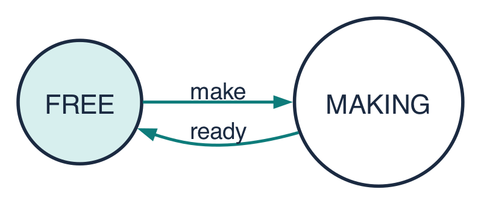
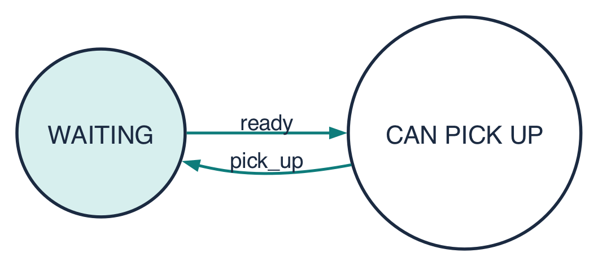

# Week 3 Exercises: Interleaving, Handshakes and Executors

**Time:** about 60 minutes in class, after the talk. Work in pairs if you like. The times below are a guide.
**Setup:** Java 21+ and Maven (see [SETUP.md](../../SETUP.md)).
**Hand in:** your answers (notes or photos of paper work are fine) and your edited `.java` files.

| # | Exercise | Kind | Time |
|---|---|---|---|
| D1 | Interleave two diagrams | paper | 10 min |
| D2 | A handshake: barista and customer | paper | 10 min |
| J1 | Fare quotes with an executor | Java | 25 min |
| J2 | Which outputs are possible? | paper + Java | 15 min |

The programs are in the Maven project `starter/` (sources in `starter/src/main/java/concurrency/week3/`). Run them from that folder:

| Program | Command |
|---|---|
| FareQuotes | `mvn -q compile exec:exec -Dmain=FareQuotes` |
| TwoBaristas | `mvn -q compile exec:exec -Dmain=TwoBaristas` |

---

## D1: Interleave two diagrams (10 min, paper)

A printer does `print` then `eject`. A scanner does `scan` then `save`. They share no actions and run at the same time.

**(a)** Draw the two small state diagrams.

**(b)** List every possible order of the four actions. How many are there?

**(c)** Why is `eject print scan save` not on your list?

## D2: A handshake (10 min, paper)

Here are the barista and customer from the tutorial. They share the action `ready`, so they must do it together. They start in FREE and WAITING.

**(a)** Which action can happen first? Why not the others?

**(b)** Which of these sequences can happen? For each one that can't, say where it gets stuck.
(i) `make ready pick_up make ready pick_up`  (ii) `make ready make pick_up ready`  (iii) `make make ready`  (iv) `make ready make ready`

**(c)** Suppose the barista has done `make ready make`, and the customer hasn't picked up yet. What is the only action that can happen next? What does this mean in the coffee shop?

## J1: Fare quotes with an executor (25 min, `FareQuotes.java`)

A ride-sharing app has five ride requests waiting. Before it can show the riders their prices, it asks a pricing service for a quote for each ride. The pricing service is slow on purpose (0.8 seconds per quote), to act like waiting on the network. `quoteSequentially` is already written: it asks for one quote at a time.

**(a)** Complete `quoteConcurrently`. It follows the same pattern as the coffee orders in tutorial section B.3, with ride requests in place of orders and fares in place of drinks: submit one task per request, keep the `Future`s, then add up the fares. Run it. Both versions should report the same total. Record both times.

**(b)** The pool has 4 threads, and there are 5 ride requests. Why isn't the concurrent time about 0.8 seconds? Predict the time with `newFixedThreadPool(5)`, then try it.

**(c)** Now make the classic mistake from tutorial section B.4: call `get()` straight after `submit()`. Run it and record the time. Is the total still right? Why is it so much slower? Then change it back.

## J2: Which outputs are possible? (15 min, paper, then `TwoBaristas.java`)

Two baristas call out drinks as they finish them. Ana makes a `latte`, then a `mocha`. Ben makes a `chai`, then a `cocoa`. Each barista is a thread, and the program records the order of the four calls. It runs this 2,000 times and counts how often each order appears.

**(a)** *Before running it,* list every possible order of the four calls on paper. How many are there? Is `mocha latte chai cocoa` possible? Is `chai latte mocha cocoa`?

**(b)** Run it. How many of your orders appeared? Which was most common, and why might that be? Does an order that never appeared count as impossible?

**(c)** Complete the `TODO` in `callOut` (one line), so that each barista pauses for a tiny random time before each call. Run it again. What changed? What does this tell you about testing concurrent programs?

---

## Optional extras (not needed in class)

- **Virtual threads:** change the `FareQuotes` pool to `Executors.newVirtualThreadPerTaskExecutor()`. What is the time now, and why does this suit a ride-sharing app (tutorial section B.5)?
- **Challenge: stepping two diagrams together.** The Maven project `challenge/` asks you to write a method that combines two state diagrams, following the handshake rule, and finds any state where they get stuck. `mvn test` in `challenge/` checks your work.
