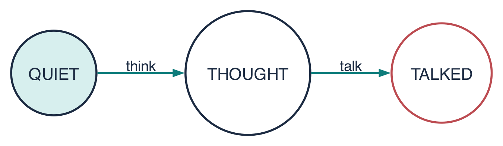
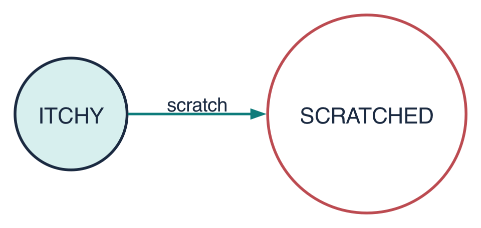
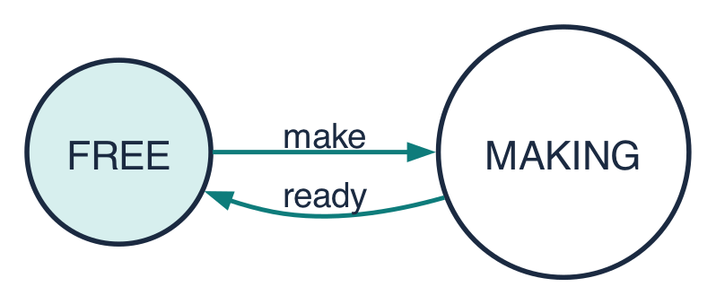
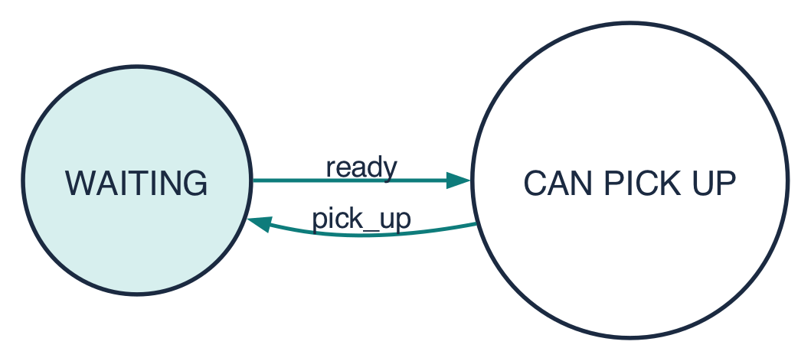

# Week 3 Tutorial: Concurrent Execution

*Handout for CS II, Week 3. Follow along during the short talk, then use it as a reference for the exercises. Based on Magee & Kramer, Concurrency: State Models & Java Programs, ch. 3 [MK06]. Keys in brackets refer to [REFERENCES.md](../REFERENCES.md).*

**This week (about 100 minutes in class):** a 35-minute talk, then about 60 minutes of exercises (`exercises/README.md`).

**By the end you should be able to:**

1. List the possible orders of the actions of two independent threads.
2. Explain what happens when two processes must do an action *together*.
3. Run tasks with an `ExecutorService` and collect their results with `Future`.
4. Predict which outputs of a small multi-threaded program are possible.

---

## Part A: Two diagrams at once

### A.1 Independent processes interleave

Here are two processes that have nothing to do with each other [MK06]: someone thinking and then talking, and an itch being scratched.





If they run at the same time, each process still does its own actions in its own order, but the two can mix in any way:

```
think talk scratch
think scratch talk
scratch think talk
```

Those are the only three orders. `talk think scratch` is impossible, because `think` always comes before `talk`. This is the same **interleaving** you listed by hand in Week 1.

Interleaving is the picture of concurrency we use all course. Threads that share variables need some extra rules on top of it, which start in Week 4.

### A.2 Make no assumptions about speed

Which order will actually happen? We don't know, and a correct program must not depend on it. We make **no assumptions about how fast each thread runs**: a thread started first may finish last, and the order can change from run to run [MK06].

Some orders may be very rare. An order you have never seen in testing is not an impossible order. Exercise J2 shows this.

### A.3 Doing something together

Independent processes aren't very useful; real processes cooperate. In a state diagram, **when two processes both have the same action, they must do it at the same moment**, like a handshake: neither can do it until the other is ready [MK06].

A barista and a customer both have the action `ready`, the moment the drink is handed over:





Step through them together, starting in FREE and WAITING:

| Next action | Who takes part | Barista is now | Customer is now |
|---|---|---|---|
| `make` | barista alone | MAKING | WAITING |
| `ready` | **both, together** | FREE | CAN PICK UP |
| `pick_up` | customer alone | FREE | WAITING |

So the customer can't `pick_up` before `ready`, because their diagram has no such arrow yet. And `ready` is one action shared by both, not two separate actions. Whoever gets there first has to wait for the other. That waiting is how processes stay in step.

### A.4 Example: a shared-ride van

A van leaves only when all three seats are taken (the book's example is a roller coaster [MK06]):


Each passenger's `board` is shared with the van, so a passenger can only board when the van can accept them. In FULL, `board` isn't possible, so a fourth passenger must wait for the next trip.

---

## Part B: Many threads in Java

Back to the coffee shop from A.3, this time in Java.

### B.1 Tasks and threads

In Week 2 you made each `Thread` yourself. That gets awkward when there are many pieces of work: threads cost resources, and you must start and join each one. A coffee shop doesn't hire a new barista for every order. It separates two ideas:

- a **task** is a piece of work (*what* to do): an order;
- a **thread** is what runs it (*who* does it): a barista.

Any free barista takes the next order. In Java, a task is a `Runnable`, or a **`Callable`** if it returns a result. In Week 2 you wrote a class that `implements Runnable`, with a `run()` method. A `Callable` is the same idea, but its one method, `call()`, returns a result. Making a drink gives back the drink, so an order is a `Callable<String>`:

```java
class DrinkOrder implements Callable<String> {
    private final String drink;

    DrinkOrder(String drink) {
        this.drink = drink;
    }

    @Override
    public String call() throws Exception {
        return makeDrink(drink);   // takes a while, then hands back the drink
    }
}
```

An order for a latte is then `new DrinkOrder("latte")`.

### B.2 `ExecutorService`: a team of baristas

An `ExecutorService` keeps a set of threads and hands tasks to them [JTut]. Here is a shop with two baristas and three orders:

```java
try (ExecutorService baristas = Executors.newFixedThreadPool(2)) {
    baristas.submit(new DrinkOrder("latte"));
    baristas.submit(new DrinkOrder("mocha"));
    baristas.submit(new DrinkOrder("chai"));
}   // leaving the try block waits for every drink to be made
```

With two baristas, at most two drinks are made at once; the chai waits in line until a barista is free. `submit` returns immediately, like a cashier who takes an order and moves on to the next customer.

### B.3 `Future`: your order ticket

`submit` can't hand you the drink, because it may not have been made yet. It gives you a **`Future`**: an order ticket you trade for the drink later. Calling `get()` on the ticket waits until the drink is ready, then returns it:

```java
List<Future<String>> tickets = new ArrayList<>();
for (String drink : orders) {
    DrinkOrder order = new DrinkOrder(drink);
    tickets.add(baristas.submit(order));    // take every order first
}
for (Future<String> ticket : tickets) {
    System.out.println(ticket.get());       // then collect the drinks
}
```

`get()` makes your code wait until the drink is made, like a customer waiting at the counter. Only the code that calls `get()` waits; the baristas carry on with other orders.

### B.4 The classic mistake

Picture a cashier who takes one order, then stands at the counter until that drink is made before taking the next order. There are two baristas, but only one is ever busy. In code, that is calling `get()` straight after `submit()`:

```java
for (String drink : orders) {
    DrinkOrder order = new DrinkOrder(drink);
    System.out.println(baristas.submit(order).get());   // don't do this
}
```

Every drink still gets made, but `get()` waits for each one before the next order is even taken, so the drinks are made **one at a time**. You have a team of baristas and no concurrency. The rule: **submit everything first, then collect**.

### B.5 Choosing an executor

A coffee shop has a fixed number of baristas, because making a drink keeps a barista busy the whole time. A ride-sharing app, like the van in A.4, is different. When riders request rides, the app's server spends most of each request *waiting*: for drivers' locations, for the map service, for the payment to go through. For work like that, Java can give every task its own lightweight **virtual thread** (Week 2) [JEP444]. Here `DriverSearch` is a `Callable`, written just like `DrinkOrder`, that finds a driver for one request:

```java
try (ExecutorService dispatch = Executors.newVirtualThreadPerTaskExecutor()) {
    for (RideRequest request : requests) {
        dispatch.submit(new DriverSearch(request));   // mostly waiting on the network
    }
}
```

| Executor | Like | Use it when |
|---|---|---|
| `Executors.newFixedThreadPool(n)` | a coffee shop with `n` baristas | you want at most `n` tasks at once, for example computing tasks with `n` about the number of cores |
| `Executors.newVirtualThreadPerTaskExecutor()` | a ride app with many requests waiting at the same time | tasks mostly *wait* (network, disk): each gets its own virtual thread. Waiting becomes cheap, but computing doesn't get any faster [JEP444] |

---

## Key terms

| Term | Meaning |
|---|---|
| interleaving | the actions of independent processes mixing in any order that keeps each process's own order |
| shared action | an action in two processes' diagrams; they must do it at the same moment |
| task | a piece of work, like an order: a class that implements `Runnable`, or `Callable` if it returns a result |
| thread pool | a set of threads that take tasks as they become free |
| `ExecutorService` | Java's interface for running tasks without managing threads yourself |
| `Future` | an order ticket for a task's result; `get()` waits for it |

## Check your understanding

1. Process X does `a` then `b`; process Y does `c`. List every possible order.
2. In the barista and customer example, is `make pick_up` a trace? Why or why not?
3. A shop has 2 baristas, and 4 orders come in that each take 1 minute to make. The orders are submitted and collected correctly. About how long until all four drinks are ready?
4. What goes wrong if the code calls `get()` right after each `submit()`?

<details>
<summary>Answers</summary>

1. `a b c`, `a c b`, `c a b`.
2. No: `pick_up` needs the customer in CAN PICK UP, which needs `ready` first.
3. About 2 minutes: two drinks at a time, in two rounds.
4. Each drink must be finished before the next order is taken, so the drinks are made one at a time. Every drink still gets made, but there is no speed-up.

</details>
